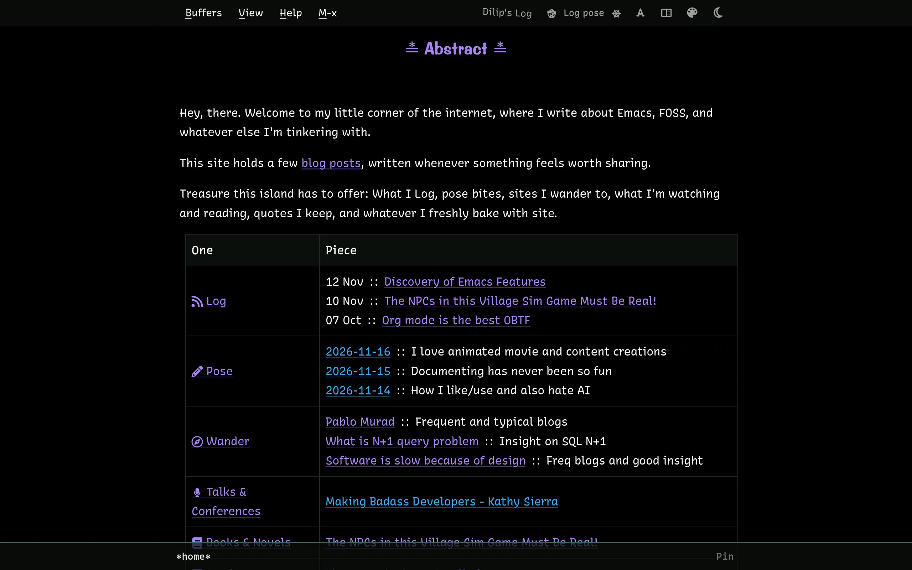
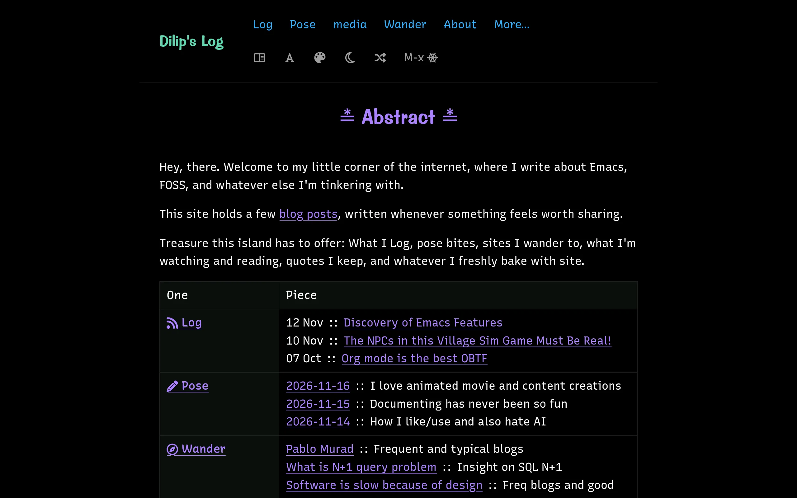
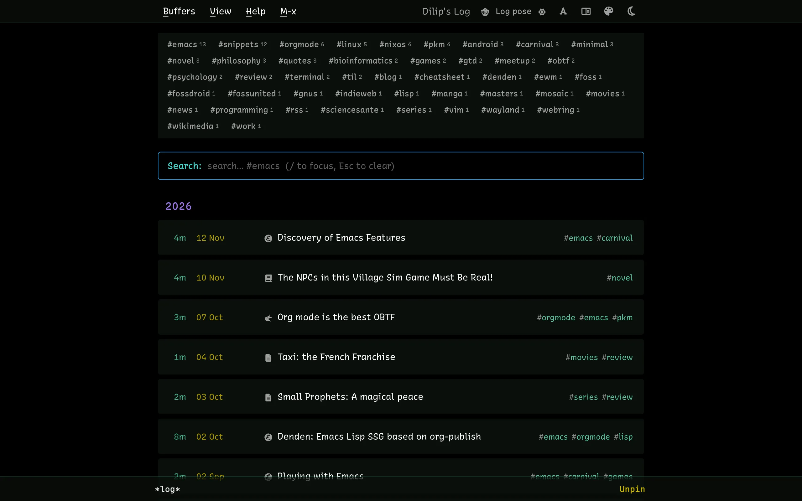
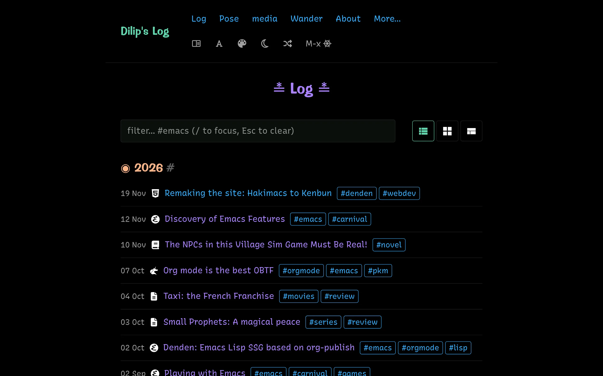
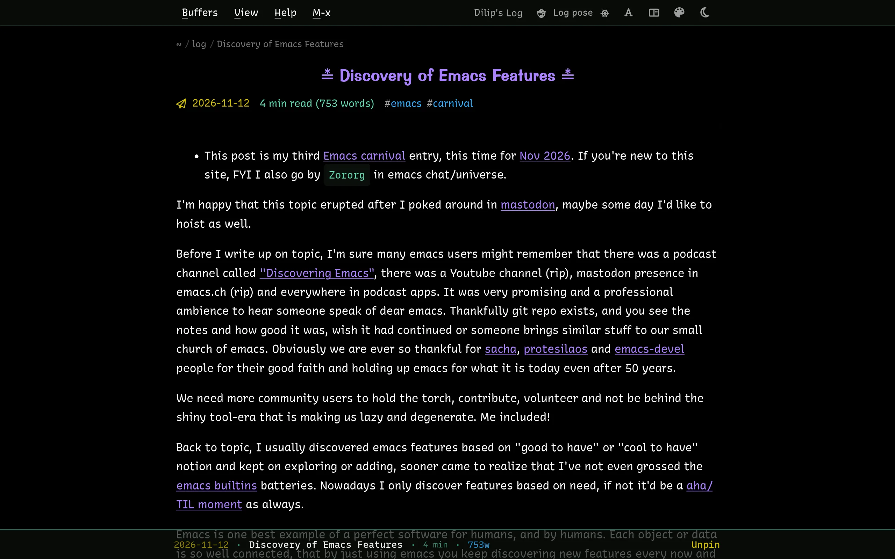
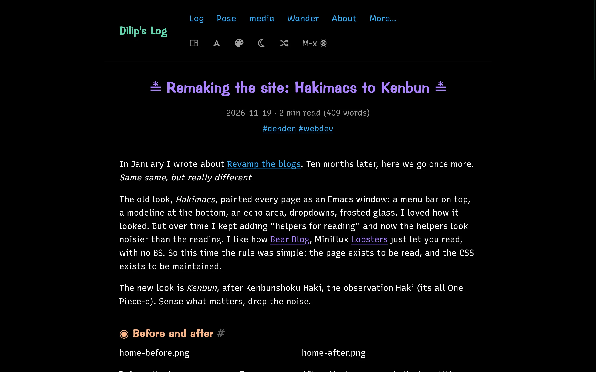

#+title: Remaking the site: Hakimacs to Kenbun
#+date: 2026-11-19
#+tags: denden webdev

In January I wrote about [[file:revamp-blog-2026.org][revamping the blog]] and in march about [[file:emacs-theme-site.org]]. Now, here we go once more. /Same same, but really different/

The old look, [[https://github.com/idlip/hakimacs][Hakimacs]], painted every page as an Emacs window: a menu bar on top, a modeline at the bottom, an echo area, dropdowns, frosted glass. I loved how it looked. But over time I kept adding "helpers for reading" and now the helpers look noisier than the reading. I like how [[https://bearblog.dev/][Bear Blog]], Miniflux [[https://lobste.rs/][Lobsters]] just let you read, with no BS. So this time the rule was simple: the page exists to be read, and the CSS exists to be maintained.

The new look is /Kenbun/, named after [[https://onepiece.fandom.com/wiki/Haki/Observation_Haki][Kenbunshoku Haki]], the observation Haki (its all One Piece-d). Sense what matters, drop the noise.

* Before and after

#+begin_grid
#+caption: Before: the home page as an Emacs window, with menu bar and modeline

#+caption: After: the home page in Kenbun, title, links and a plain column

#+end_grid

#+begin_grid
#+caption: Before: the posts listing page

#+caption: After: the new simple listing page

#+end_grid

#+begin_grid
#+caption: Before: a post inside the Emacs frame

#+caption: After: the same post, just the words

#+end_grid

* What went
- The fake Emacs frame: menu bar, modeline, echo area, hamburger menu.
- Breadcrumbs, the reading progress bar, sidenotes, code copy buttons, the image lightbox.
- A random colour scheme on every visit, the themes gallery, and the rain confetti on badges.

* What stayed, because I want it
- My fonts, the heading glyphs, and the five font modes.
- base16 colour schemes, with Haki as the default.
- The command palette with its glass blur, one place to search and navigate everything.
- The spinning glow on hover, the badges, and the WANTED poster on the 404 page.

* By the numbers
| File      | Before | After |
|-----------+--------+-------|
| =theme.css= |   3365 |   915 |
| =index.js=  |   1436 |   822 |
| =theme.el=  |   1219 |   565 |

* What I kept in mind
- Style plain HTML elements first, and keep a short list of shared pieces. A new page reuses them; it
  never gets its own CSS.
- Trust the browser: =
= for folding, =<dialog>= for the palette, a popover for small notes.
- Readable or gone. Every colour scheme is checked for contrast when the site is built, and only 140 pass AAA out of 306 schemes.

/Read more, write more, give more/
